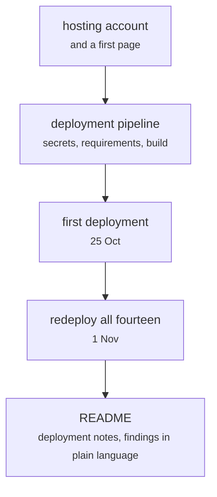

# sentiment-app/README.md and the deployment

Front end · Hara · P2 · due 2 Nov 2026 · Complete

The hosted Streamlit page the live-testing sessions tested against: first deployment 25 October, all fourteen models by 1 November.

## What it does

The deployment pipeline (secrets, requirements, the hosting build), the first deployment with the first few models, the redeployment of all fourteen, and the README with the deployment notes and the findings in plain language.

## Architecture

## Depends on

- [sentiment-app/app.py](sentiment-app-app-py.md)
- [.github/workflows/ci.yml](github-workflows-ci-yml.md)

## Affects

- [deploy/Dockerfile](deploy-dockerfile.md)
- [docs/presentation/](docs-presentation.md)

## Reads and writes

| Reads | Writes |
|---|---|
| `nothing on disk` | `the deployed page` |

## Todos

- [x] First deployment: the first few models live (Hara, 2 h, 25 Oct)
- [x] Redeploy all fourteen models (Hara, 2 h, 1 Nov)
- [x] Deployment pipeline: secrets, requirements, the hosting build (Hara, 2 h, 23 Oct)
- [x] Deployment notes and the findings in plain language (Hara, 1 h, 2 Nov)
- [x] Hosting account and a first Streamlit page (Hara, 2 h, 9 Oct)

Open items live as sub-issues of the program's issue: [open it on GitHub](https://github.com/hputhireth/Technology-and-Design/issues?q=is%3Aissue+label%3Aprogram+%22sentiment-app-readme-md-and-the-deployment%22).

## Meetings

| Date | Rating | Note |
|---|---|---|
| 25 Oct 2026 | 4/5 | First deployment demonstrated on the Sunday call. |
| 1 Nov 2026 | 5/5 | All fourteen models redeployed. |

## Hours

9 h over 5 todos, 9 h done. By week: Sprint 2 2 h, Sprint 3 2 h, Sprint 4 3 h, Before the sprints 2 h.

[Back to the backlog](../README.md) · [Pipeline map](../PIPELINE.md)
