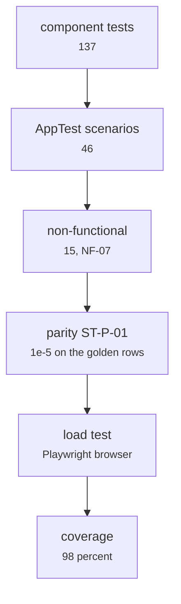

# sentiment-app/tests/ (213 tests)

Front end · Hara · P1 · due 1 Nov 2026 · Complete

137 component tests, 46 AppTest scenarios, 15 non-functional checks, the parity tests to 1e-5 and a load test under a Playwright browser.

## What it does

The application's own suite. The component tests cover the store, the catalog and the numpy pass; the AppTest scenarios drive the pages; the non-functional checks include NF-07, no path, login or address in any export; ST-P-01 holds every shipped head to the pipeline's stored probabilities to 1e-5 on the golden rows; the load test runs under a Playwright browser. 213 passed, 1 skipped, 98 percent coverage.

## Architecture

## Depends on

- [sentiment-app/app.py](sentiment-app-app-py.md)
- [sentiment-app/build_models.py](sentiment-app-build-models-py.md)
- [tests/unit/](tests-unit.md)
- [tests/forbidden_patterns.py](tests-forbidden-patterns-py.md)

## Affects

- [.github/workflows/ci.yml](github-workflows-ci-yml.md)
- [docs/test_plan.md](docs-test-plan-md.md)

## Reads and writes

| Reads | Writes |
|---|---|
| `the model store` | `the test report` |
| `golden_readings.json` |  |

## Todos

- [x] 137 component tests (Hara, 1.5 h, 25 Oct)
- [x] 46 AppTest scenarios (Hara, 2.5 h, 31 Oct)
- [x] 15 non-functional checks (NF-07: no path, login or address in an export) (Hara, 1.5 h, 31 Oct)
- [x] Parity tests against the pipeline's stored probabilities to 1e-5 (Hara, 1.5 h, 1 Nov)
- [x] First component tests (Hara, 2 h, 23 Oct)
- [x] Load test under a Playwright browser (Hara, 1 h, 1 Nov)
- [x] Defect log for the application tests (Johnny, 1.5 h, 29 Oct)

Open items live as sub-issues of the program's issue: [open it on GitHub](https://github.com/hputhireth/Technology-and-Design/issues?q=is%3Aissue+label%3Aprogram+%22sentiment-app-tests%22).

## Meetings

| Date | Rating | Note |
|---|---|---|
| 30 Oct 2026 | 4/5 | Component tests and the first AppTest scenarios. |
| 1 Nov 2026 | 5/5 | 213 passed, 1 skipped, 98 percent coverage. |

## Hours

11.5 h over 7 todos, 11.5 h done. By week: Sprint 2 2 h, Sprint 3 3 h, Sprint 4 6.5 h.

[Back to the backlog](../README.md) · [Pipeline map](../PIPELINE.md)
