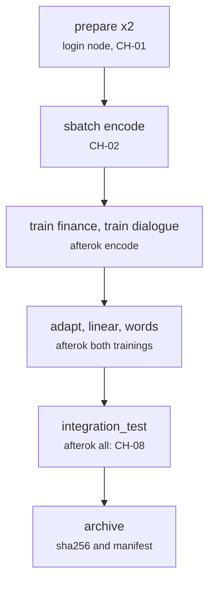

# slurm/chain.sh

Final pipeline · Ricky · P1 · due 3 Nov 2026 · Complete

The whole chain as one submission: prepare on the login node, then seven jobs with afterok dependencies, the integration test last.

## What it does

Runs prepare for both configs, then submits encode, the two training jobs, adapt, linear and words with afterok dependencies, and the integration test depending on all of them, so the test never runs on a partial tree. Submitted four times on 2 and 3 November: the environment fault, the positional config, three checker fixes against the real tree, the mutation count; the fourth submission ended with CH-08 PASS, 154 checks, and the archive was packed and its checksum verified.

## Architecture

## Depends on

- [slurm/_header.sh](slurm-header-sh.md)
- [env/paths.sh](env-paths-sh.md)
- [tests/smoke.sh](tests-smoke-sh.md)

## Affects

- [tests/integration/check_results.py](tests-integration-check-results-py.md)
- [tests/integration/mutate.py](tests-integration-mutate-py.md)
- [docs/A3_Design_Document.docx](docs-a3-design-document-docx.md)

## Reads and writes

| Reads | Writes |
|---|---|
| `nothing on disk` | `logs/chain_<date>.log` |
|  | `the archive of the project folder` |

## Todos

- [x] afterok dependencies: encode, train x2, adapt, linear, words, the integration test last (Ricky, 0.5 h, 1 Nov)
- [x] Submission 1: the environment fault (Python 3.9, CUDA 12.8 wheels) (Ricky, 0.5 h, 2 Nov)
- [x] Submission 2: both training jobs on the finance head (Ricky, 0.5 h, 2 Nov)
- [x] Submission 3: 149 of 154; the manifests, six decimals, the KL band (Ricky, 0.5 h, 3 Nov)
- [x] Submission 4: CH-08 PASS; the archive packed and its checksum verified (Ricky, 0.5 h, 3 Nov)
- [x] Regression suite green before the review; the defect log closed (Johnny, 1.5 h, 3 Nov)

Open items live as sub-issues of the program's issue: [open it on GitHub](https://github.com/hputhireth/Technology-and-Design/issues?q=is%3Aissue+label%3Aprogram+%22slurm-chain-sh%22).

## Meetings

| Date | Rating | Note |
|---|---|---|
| 2 Nov 2026 | 2/5 | Submissions one and two failed on the environment and the configuration. |
| 3 Nov 2026 | 5/5 | Submission four: 154 PASS, 8 FAIL on the broken copy, exit 0 on the clean tree. |

## Hours

4 h over 6 todos, 4 h done. By week: Sprint 4 4 h.

[Back to the backlog](../README.md) · [Pipeline map](../PIPELINE.md)
