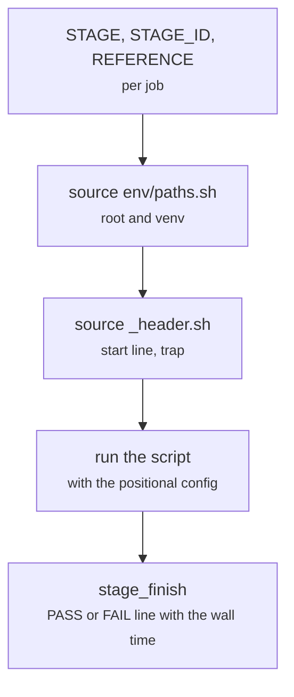

# slurm/_header.sh, encode.sh, train.sh, predict.sh, adapt.sh, linear.sh, words.sh

Final pipeline · Ricky · P1 · due 2 Nov 2026 · Complete

The job scripts with their allocations; the shared header writes one dated PASS or FAIL line with the wall time to the chain log.

## What it does

Each job script sets its stage id and reference, sources env/paths.sh and _header.sh, and runs its script. _header.sh records the node, the allocation and the Python in the job's own log, traps the exit and appends one dated line with the duration to logs/chain_<date>.log. The configuration travels as a positional argument, because sbatch does not pass environment variables into a job: the second fault of 3 November, when both training jobs trained the finance head.

## Architecture

## Depends on

- [env/paths.sh](env-paths-sh.md)
- [common/runlog.py](common-runlog-py.md)

## Affects

- [slurm/chain.sh](slurm-chain-sh.md)
- [tests/integration/check_results.py](tests-integration-check-results-py.md)

## Reads and writes

| Reads | Writes |
|---|---|
| `nothing on disk` | `logs/<stage>_<jobid>.txt` |
|  | `logs/chain_<date>.log` |

## Todos

- [x] One job script per stage with its allocation (Ricky, 0.5 h, 28 Oct)
- [x] _header.sh: a dated PASS or FAIL line with the wall time in the chain log (Ricky, 0.5 h, 1 Nov)
- [x] The config as a positional argument after both jobs trained the finance head (Ricky, 0.5 h, 2 Nov)

Open items live as sub-issues of the program's issue: [open it on GitHub](https://github.com/hputhireth/Technology-and-Design/issues?q=is%3Aissue+label%3Aprogram+%22slurm-header-sh%22).

## Meetings

| Date | Rating | Note |
|---|---|---|
| 2 Nov 2026 | 2/5 | Two CH-03 lines in the chain log: sbatch does not pass environment variables into a job. |

## Hours

1.5 h over 3 todos, 1.5 h done. By week: Sprint 3 0.5 h, Sprint 4 1 h.

[Back to the backlog](../README.md) · [Pipeline map](../PIPELINE.md)
