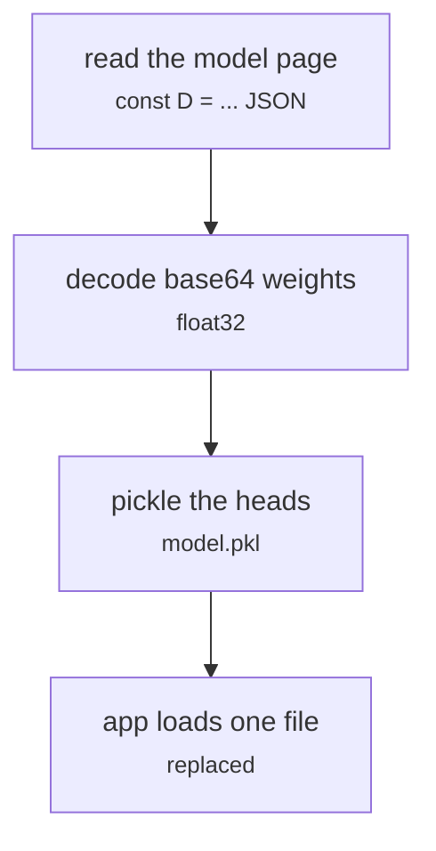

# streamlit-a3/train_model.py (model.pkl from the model pages)

Front end · Hara · P5 · due 27 Oct 2026 · Cancelled

The first store: the heads unpacked from the model pages into one model.pkl. Replaced by build_models.py reading the exports.

> Replaced on 27 October by build_models.py, which reads the exports directly.

## What it does

The first deployment read each head's weights out of its model page (model_a.html and the like) and pickled them together so the app loaded one file. Once the pipeline exported nn_model.json directly, the store was rebuilt from the exports and the pickle route was dropped.

## Architecture

## Depends on

- `the model pages of the research pipeline`

## Affects

- [sentiment-app/build_models.py](sentiment-app-build-models-py.md)

## Reads and writes

| Reads | Writes |
|---|---|
| `model_a.html` | `model.pkl` |
| `model_a_sentfin.html` |  |
| `dialogue_head_fingpt_sentfin.html` |  |

## Todos

- [x] Unpack the heads from the model pages into model.pkl (Hara, 1 h, 26 Oct)
- [ ] ~~Keep model.pkl as the store~~ (Hara, 0.5 h, 27 Oct), cancelled

Open items live as sub-issues of the program's issue: [open it on GitHub](https://github.com/hputhireth/Technology-and-Design/issues?q=is%3Aissue+label%3Aprogram+%22streamlit-a3-train-model-py%22).

## Meetings

| Date | Rating | Note |
|---|---|---|
| 27 Oct 2026 | 3/5 | Dropped in favour of the exports. |

## Hours

1.5 h over 2 todos, 1 h done. By week: Sprint 3 1.5 h.

[Back to the backlog](../README.md) · [Pipeline map](../PIPELINE.md)
