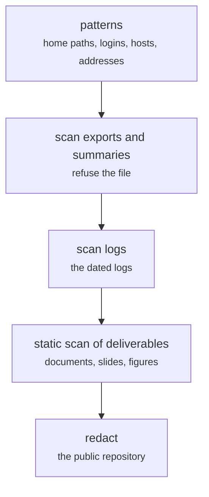

# tests/forbidden_patterns.py (the security scan)

Test layers · Ricky · P2 · due 1 Nov 2026 · Complete

Nothing leaves the SuperComputer carrying a login, a host name or a project path: the forbidden-pattern tests and the static scan of every deliverable.

## What it does

A test over every export, summary and log that refuses a file carrying a home path, a login or an address (NF-07 and ST-F-07 on the application side), and a static scan run over every document, slide and figure before it leaves. The public repository carries the login redacted; the result files carry paths relative to the project root only.

## Architecture

## Depends on

- [common/runlog.py](common-runlog-py.md)
- [common/head.py](common-head-py.md)

## Affects

- [sentiment-app/build_models.py](sentiment-app-build-models-py.md)
- [sentiment-app/tests/](sentiment-app-tests.md)
- [docs/security_writeup.md](docs-security-writeup-md.md)

## Reads and writes

| Reads | Writes |
|---|---|
| `results/**` | `the scan report` |
| `logs/**` |  |
| `the deliverables` |  |

## Todos

- [x] Forbidden-pattern tests: no login, host or project path in any export or log (Ricky, 0.5 h, 28 Oct)
- [x] Deployment hardening on the application side (Hara, 1 h, 29 Oct)
- [x] The static scan over every deliverable before it leaves (Ricky, 0.25 h, 1 Nov)

Open items live as sub-issues of the program's issue: [open it on GitHub](https://github.com/hputhireth/Technology-and-Design/issues?q=is%3Aissue+label%3Aprogram+%22tests-forbidden-patterns-py%22).

## Meetings

| Date | Rating | Note |
|---|---|---|
| 30 Oct 2026 | 4/5 | Security write-up reviewed; the scan run over the public copy. |

## Hours

1.75 h over 3 todos, 1.75 h done. By week: Sprint 3 1.5 h, Sprint 4 0.25 h.

[Back to the backlog](../README.md) · [Pipeline map](../PIPELINE.md)
