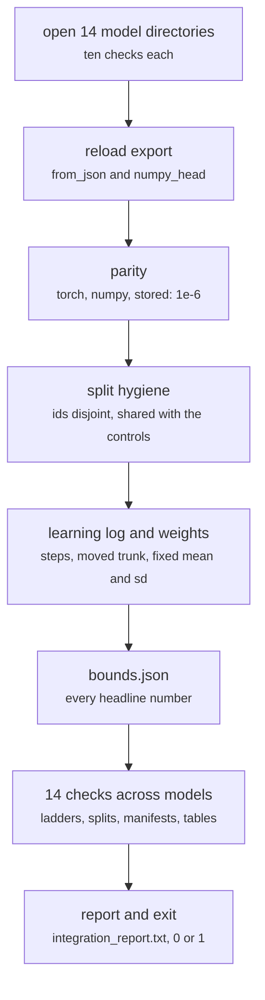

# tests/integration/check_results.py, bounds.json, slurm/integration_test.sh

Test layers · Ricky · P1 · due 3 Nov 2026 · Complete

154 checks over every model's files: schema, parity to 1e-6, split hygiene, the bounds of the design document. The last job of the chain.

## What it does

Opens each of the fourteen model directories (ten checks each) and runs fourteen checks across models: the export reloads, the numpy pass equals the torch pass and the stored number to 1e-6, confirmation ids are disjoint from every training fold and shared with the controls, the learning log has steps = epochs x ceil(rows / batch), the GRPO trunk differs from its start while mean, sd and temperatures do not, the confirmation score lies inside the cross-validation band, and every headline number of the document holds to its bound in bounds.json. Writes results/integration_report.txt and exits 0 or 1; integration_test.sh runs it as CH-08.

## Architecture

## Depends on

- [tests/unit/](tests-unit.md)
- [scripts/train.py](scripts-train-py.md)
- [scripts/predict.py](scripts-predict-py.md)
- [scripts/adapt.py](scripts-adapt-py.md)
- [scripts/linear.py](scripts-linear-py.md)
- [scripts/words.py](scripts-words-py.md)
- [common/runlog.py](common-runlog-py.md)

## Affects

- [tests/integration/mutate.py](tests-integration-mutate-py.md)
- [slurm/chain.sh](slurm-chain-sh.md)
- [docs/A3_Design_Document.docx](docs-a3-design-document-docx.md)
- [docs/test_plan.md](docs-test-plan-md.md)

## Reads and writes

| Reads | Writes |
|---|---|
| `results/**` | `results/integration_report.txt` |
| `features/<key>/manifest.json` | `logs/integration_<date>.log` |
| `data/cache/*/manifest.json` |  |
| `tests/integration/bounds.json` |  |

## Todos

- [x] Ten checks per model directory: files, reload, parity to 1e-6, split hygiene (Ricky, 0.5 h, 31 Oct)
- [x] Fourteen checks across models: the two ladders, shared splits, manifests, tables (Ricky, 0.5 h, 1 Nov)
- [x] bounds.json from the document's numbers; the KL band from the derivation [0.3, 1.8] (Ricky, 0.5 h, 3 Nov)
- [x] integration_test.sh as the last job; the exit status is the test's (Ricky, 0.5 h, 1 Nov)

Open items live as sub-issues of the program's issue: [open it on GitHub](https://github.com/hputhireth/Technology-and-Design/issues?q=is%3Aissue+label%3Aprogram+%22tests-integration-check-results-py%22).

## Meetings

| Date | Rating | Note |
|---|---|---|
| 2 Nov 2026 | 3/5 | 149 of 154 on the first complete run: manifests, decimals and a copied band. |
| 3 Nov 2026 | 5/5 | 154 PASS in 12.8 seconds as the last job of the chain. |

## Hours

2 h over 4 todos, 2 h done. By week: Sprint 4 2 h.

[Back to the backlog](../README.md) · [Pipeline map](../PIPELINE.md)
