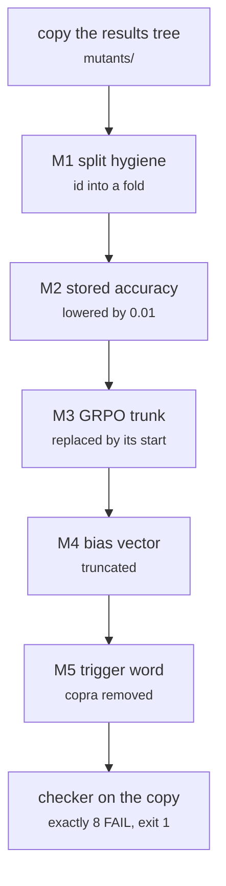

# tests/integration/mutate.py

Test layers · Ricky · P2 · due 3 Nov 2026 · Complete

Five faults seeded into a copy of the results; the checker must fail with exactly 8 FAIL lines and exit 1.

## What it does

M1 appends a confirmation id to a training fold, M2 lowers a stored accuracy by 0.01, M3 replaces a GRPO trunk by its start, M4 truncates a bias vector, M5 removes the trigger word copra. Each fault maps to a different check, so the run shows the checker's coverage. The first version raised the accuracy, which also crossed the upper bound and gave 9 FAIL lines, and a doubled submission made the day's log count 16; both fixed on 3 November.

## Architecture

## Depends on

- [tests/integration/check_results.py](tests-integration-check-results-py.md)

## Affects

- [slurm/chain.sh](slurm-chain-sh.md)
- [tests/smoke.sh](tests-smoke-sh.md)
- [docs/test_plan.md](docs-test-plan-md.md)

## Reads and writes

| Reads | Writes |
|---|---|
| `results/**` | `mutants/**` |
|  | `logs/mutation_<date>.log` |

## Todos

- [x] Exactly 8 FAIL lines and exit 1; count only the last run in the day's log (Ricky, 0.5 h, 3 Nov)
- [x] Five faults into a copy: M1 to M5 (Ricky, 0.5 h, 1 Nov)

Open items live as sub-issues of the program's issue: [open it on GitHub](https://github.com/hputhireth/Technology-and-Design/issues?q=is%3Aissue+label%3Aprogram+%22tests-integration-mutate-py%22).

## Meetings

| Date | Rating | Note |
|---|---|---|
| 3 Nov 2026 | 4/5 | 8 FAIL, exit 1 on the broken copy; the clean tree 154 PASS. |

## Hours

1 h over 2 todos, 1 h done. By week: Sprint 4 1 h.

[Back to the backlog](../README.md) · [Pipeline map](../PIPELINE.md)
