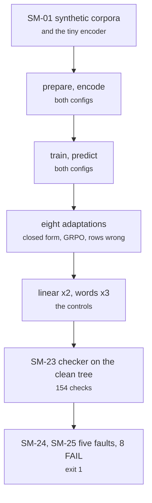

# tests/smoke.sh, tests/run_local.sh

Test layers · Ricky · P1 · due 1 Nov 2026 · Complete

The whole chain on synthetic data with a tiny random encoder, 25 steps in under three minutes, run on the login node before anything is submitted.

## What it does

Builds synthetic corpora and the tiny encoder, runs prepare, encode, train and predict for both configs, the eight adaptations, the two linear controls, the three word logits, then the integration checker on the result tree (154 checks, no bounds) and on a copy broken five ways (8 FAIL lines, exit 1). run_local.sh runs the unit suite then the smoke chain. It is the layer that exposed the mutation-count fault before the fourth submission.

## Architecture

## Depends on

- [tests/unit/](tests-unit.md)
- [scripts/prepare.py](scripts-prepare-py.md)
- [scripts/encode.py](scripts-encode-py.md)
- [scripts/train.py](scripts-train-py.md)
- [scripts/predict.py](scripts-predict-py.md)
- [scripts/adapt.py](scripts-adapt-py.md)
- [scripts/linear.py](scripts-linear-py.md)
- [scripts/words.py](scripts-words-py.md)
- [tests/integration/check_results.py](tests-integration-check-results-py.md)
- [tests/integration/mutate.py](tests-integration-mutate-py.md)

## Affects

- [slurm/chain.sh](slurm-chain-sh.md)
- [docs/test_plan.md](docs-test-plan-md.md)

## Reads and writes

| Reads | Writes |
|---|---|
| `nothing on disk` | `logs/smoke_<date>.log` |
|  | `a temporary synthetic root` |

## Todos

- [x] Synthetic corpora, the tiny random encoder, the 25 steps with the checker on the clean tree and the broken copy (Ricky, 0.5 h, 1 Nov)
- [x] SM-25 confirms the mutation count fix before the fourth submission (Ricky, 0.5 h, 3 Nov)

Open items live as sub-issues of the program's issue: [open it on GitHub](https://github.com/hputhireth/Technology-and-Design/issues?q=is%3Aissue+label%3Aprogram+%22tests-smoke-sh%22).

## Meetings

| Date | Rating | Note |
|---|---|---|
| 1 Nov 2026 | 4/5 | 25 steps in 140 seconds on the login node. |
| 3 Nov 2026 | 4/5 | SM-25 confirmed the mutation-count fix before the resubmission. |

## Hours

1 h over 2 todos, 1 h done. By week: Sprint 4 1 h.

[Back to the backlog](../README.md) · [Pipeline map](../PIPELINE.md)
