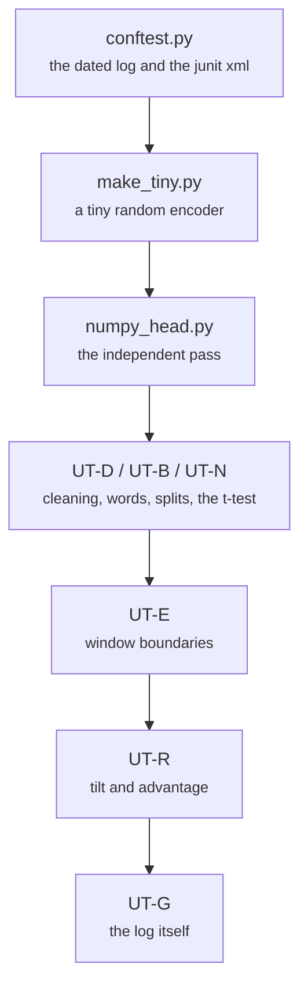

# tests/unit/ (111 tests), conftest.py, numpy_head.py, make_tiny.py

Test layers · Ricky · P1 · due 1 Nov 2026 · Complete

Every function of common/* against closed-form answers, and the torch head against an independent numpy pass: the parity oracle.

## What it does

UT-D covers the cleaning branches, UT-B the word reader, UT-N the grouping, the confirmation split and the corrected t-test on known values, UT-E the window count at 1, 509, 510, 511, 988 and 989 tokens with a tiny random encoder from make_tiny.py, UT-R the closed-form tilt and the GRPO advantage, UT-G the dated log. numpy_head.py reruns an exported head without torch and is the oracle the integration test and the application's parity tests rest on. conftest.py writes logs/unit_<date>.log, .json and a junit xml. 111 passed in 15.4 seconds on 3 November.

## Architecture

## Depends on

- [common/text.py](common-text-py.md)
- [common/cache.py](common-cache-py.md)
- [common/encoder.py](common-encoder-py.md)
- [common/head.py](common-head-py.md)
- [common/metrics.py](common-metrics-py.md)
- [common/runlog.py](common-runlog-py.md)
- [scripts/adapt.py](scripts-adapt-py.md)
- [scripts/linear.py](scripts-linear-py.md)
- [scripts/words.py](scripts-words-py.md)

## Affects

- [tests/smoke.sh](tests-smoke-sh.md)
- [tests/integration/check_results.py](tests-integration-check-results-py.md)
- [sentiment-app/tests/](sentiment-app-tests.md)
- [docs/test_plan.md](docs-test-plan-md.md)

## Reads and writes

| Reads | Writes |
|---|---|
| `the modules under common/` | `logs/unit_<date>.log` |
|  | `.json` |
|  | `.xml` |

## Todos

- [x] numpy_head.py: the independent pass from the export, the parity oracle (Ricky, 0.5 h, 29 Oct)
- [x] UT-D, UT-B, UT-N: cleaning, the word reader, splits and the corrected t-test (Ricky, 0.5 h, 31 Oct)
- [x] UT-R: the tilt and the GRPO advantage; UT-E at 1, 509, 510, 511, 988, 989 tokens; conftest writes the dated log (Ricky, 0.5 h, 1 Nov)

Open items live as sub-issues of the program's issue: [open it on GitHub](https://github.com/hputhireth/Technology-and-Design/issues?q=is%3Aissue+label%3Aprogram+%22tests-unit%22).

## Meetings

| Date | Rating | Note |
|---|---|---|
| 1 Nov 2026 | 4/5 | 111 passed in 15 seconds at the live-testing check. |

## Hours

1.5 h over 3 todos, 1.5 h done. By week: Sprint 3 0.5 h, Sprint 4 1 h.

[Back to the backlog](../README.md) · [Pipeline map](../PIPELINE.md)
